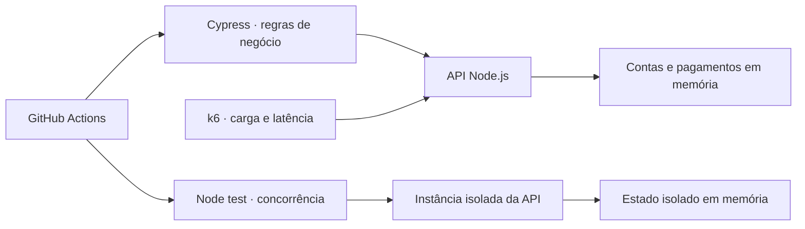

<div align="center">

# 💳 Payment Quality Lab

**Automação de testes e performance para transações de pagamentos**

Um laboratório de QA para praticar integridade financeira, idempotência e concorrência.


[](https://github.com/qadevanes-ti/auto_perfor_testes/actions/workflows/quality.yml)

[Começar](#-como-executar) · [Cenários](#-cenários-de-qualidade) · [Performance](#-performance-com-k6) · [Plano de testes](docs/test-plan.md) · [Evidências](docs/validation.md)

</div>

---

## 🎯 Sobre o projeto

Portfólio de QA para aprender qualidade de transações de meios de pagamento com uma API local e contas fictícias. O foco é verificar **o que acontece com o dinheiro**: débito e crédito corretos, rejeições sem movimentação e repetição sem cobrança duplicada.

O domínio inicial é transferência entre contas e estorno integral. O simulador não implementa protocolos Pix ou redes de cartões.

## 🧰 Tecnologias utilizadas

| Tecnologia | Aplicação no projeto |
| --- | --- |
| **JavaScript** | API, testes funcionais e scripts de carga |
| **Node.js 22** | Servidor HTTP e teste de concorrência com `node:test` |
| **Cypress** | Automação funcional da API e verificação dos saldos |
| **k6** | Geração de carga e critérios de latência e erro |
| **GitHub Actions** | Execução de testes Node e Cypress a cada push ou pull request |

## 🧪 Cenários de qualidade

| Cenário | O que é verificado | Ferramenta |
| --- | --- | --- |
| Pagamento aprovado | Valor, estado, consulta e saldos das duas contas | Cypress |
| Requisição repetida | Mesmo ID e um único débito | Cypress + Node |
| Conflito de idempotência | Mesma chave com outro valor retorna `409` | Cypress |
| Dados inválidos | Zero, negativo, fracionário, string e nulo são rejeitados | Cypress |
| Saldo insuficiente | Rejeição sem alterar os saldos | Cypress |
| Estorno repetido | Devolução integral uma única vez | Cypress |
| Pagamentos simultâneos | Disputa pelo saldo sem saldo negativo | Node |
| Carga constante | p95, falhas HTTP, falhas de negócio e carga não atendida | k6 |

**Validação local registrada:** 10 testes Cypress e 1 teste Node aprovados. O cenário k6 está preparado e ainda não foi executado no ambiente inicial. Consulte as condições em [Evidências de validação](docs/validation.md); o badge acima acompanha o estado do CI no GitHub.

## 🏗️ Como as peças se conectam



## 🚀 Como executar

Requisitos: Node.js 22. Cypress é instalado pelo npm; k6 deve estar disponível separadamente para os testes de carga.

```sh
npm install
npm start
```

Em outro terminal:

```sh
npm run cy:open
# Ou execução sem interface:
npm run cy:run
```

Os comandos `cy:open` e `cy:run` removem automaticamente a variável `ELECTRON_RUN_AS_NODE` apenas do processo Cypress, para permitir que o navegador abra a partir do terminal do editor.

Na interface, selecione **E2E Testing**, escolha um navegador, clique em **Start E2E Testing** e abra **payments.cy.js**. Mantenha `npm start` ativo em outro terminal: a interface Cypress não inicia a API automaticamente.

Teste de concorrência (cria sua própria API temporária):

```sh
npm test
```

Performance, com a API em execução:

```sh
npm run perf
```

## 📚 Trilha de aprendizado

1. **Entender o negócio:** explicar débito, crédito, saldo, estorno e idempotência. R$ 25,00 é representado por `2500` centavos.
2. **Testar APIs com Cypress:** criar dados independentes por teste; verificar status HTTP, corpo, consulta posterior e efeito nos dois saldos.
3. **Testar falhas:** valores inválidos, saldo insuficiente, repetição da requisição e conflito de chave.
4. **Investigar concorrência:** observar o teste Node que envia requisições em paralelo e verifica que o total do dinheiro é preservado.
5. **Medir performance:** executar k6, entender p95, taxa de erro, vazão e iterações descartadas. Registrar ambiente e resultados reais.
6. **Apresentar evidências:** publicar código, relatório de execução, um defeito reproduzível e uma análise dos riscos ainda não cobertos.

Para cada etapa: leia o teste, execute, explique por que cada asserção existe e adicione um cenário sem copiar o anterior inteiro. Estude a API em paralelo aos testes, mas escreva as expectativas a partir das regras abaixo.

## 💰 Regras do laboratório

- Contas começam com saldo inteiro entre 0 e 1 bilhão de centavos, informado na criação para facilitar os exercícios.
- Pagamentos transferem centavos inteiros positivos entre duas contas diferentes e existentes.
- Um pagamento aprovado debita a origem e credita o destino pelo mesmo valor, sem taxas.
- Saldo insuficiente rejeita o pagamento e preserva os dois saldos.
- `Idempotency-Key` é obrigatória no pagamento. A mesma chave e os mesmos dados devolvem o mesmo ID, sem novo débito. A mesma chave com outros dados retorna `409`.
- Apenas pagamentos aprovados reservam a chave. Uma rejeição pode ser tentada novamente.
- A consulta e a repetição por chave retornam o estado atual do pagamento, inclusive após estorno.
- O estorno é integral, devolve o dinheiro uma vez e exige que o destinatário ainda tenha saldo. Repetir o estorno retorna o pagamento já estornado.

## 🔌 Endpoints da API

| Método | Rota | Corpo / objetivo |
| --- | --- | --- |
| GET | `/health` | Saúde da API |
| POST | `/accounts` | `{ "balance": 10000 }` |
| GET | `/accounts/:id` | Consultar saldo |
| POST | `/payments` | `{ "from": "id", "to": "id", "amount": 2500 }` + cabeçalho `Idempotency-Key` |
| GET | `/payments/:id` | Consultar pagamento |
| POST | `/payments/:id/refund` | `{}` para estorno integral |

## 📊 Performance com k6

O cenário agenda **10 iterações por segundo durante 30 segundos**. Cada iteração cria duas contas e faz um pagamento: não confunda iterações por segundo com requisições por segundo. Preparar contas dentro da iteração também afeta a capacidade de gerar carga.

Critérios didáticos: p95 dos pagamentos abaixo de 300 ms, menos de 1% de falhas HTTP, zero falhas de negócio e zero iterações descartadas. São hipóteses para aprender, não SLAs de banco. Um status HTTP esperado sem o valor e estado corretos também reprova o cenário.

O gerador e a API na mesma máquina disputam recursos. Registre hardware, versões, duração, carga e limitações antes de comparar resultados. Não conclua capacidade de produção com este simulador.

## 🗂️ Estrutura do projeto

```text
.
├── .github/workflows/quality.yml  # Pipeline de testes funcionais
├── cypress/e2e/payments.cy.js     # Cenários de API com Cypress
├── docs/
│   ├── test-plan.md              # Estratégia e exercícios pendentes
│   └── validation.md             # Evidências da validação local
├── performance/payments.js       # Cenário de carga com k6
├── scripts/cypress.js            # Inicializador compatível com o editor
├── src/server.js                 # Simulador de pagamentos
├── test/concurrency.test.js      # Requisições simultâneas
└── cypress.config.js             # Configuração do Cypress
```

## 🛠️ Comandos disponíveis

| Comando | Finalidade | API precisa estar rodando? |
| --- | --- | --- |
| `npm start` | Iniciar API em `http://127.0.0.1:3000` | Inicia a API |
| `npm run cy:open` | Abrir a interface do Cypress | Sim |
| `npm run cy:run` | Executar Cypress sem interface | Sim |
| `npm test` | Executar teste de concorrência | Não; cria uma instância temporária |
| `npm run perf` | Executar carga com k6 instalado | Sim |

## 🧭 Próximos exercícios

- Complete os cenários pendentes na [matriz de testes](docs/test-plan.md).
- Introduza um defeito: remova temporariamente a proteção de idempotência. Veja os testes falharem e restaure o código.
- Simule resposta perdida após aprovação e repita a operação com a mesma chave; confirme que não há novo débito.
- Adicione persistência e teste recuperação após reinício.
- Modele lançamento contábil e conciliação; compare movimentos com saldos finais.
- Adicione estados pendentes e um provedor externo simulado para estudar timeout, retry e callbacks duplicados ou fora de ordem.
- Evolua para PostgreSQL com transações e execute testes entre múltiplas instâncias.
- Adicione autenticação e autorização por conta, com testes de acesso indevido.
- Crie cenários separados de carga gradual, pico e longa duração; compare resultados com o baseline.

## 🔎 Escopo e limitações

Este é um simulador local sem autenticação, persistência, ledger contábil ou integração bancária. As operações são síncronas em um único processo Node; não há garantia de atomicidade distribuída. Dados e chaves desaparecem ao reiniciar. A criação livre de saldo é uma facilidade de estudo. Use apenas dados fictícios.

Testes reduzem riscos dentro da cobertura e das condições exercitadas; não garantem ausência de defeitos nem conformidade bancária.

## 🔗 Referências

- [Testes de API com Cypress](https://docs.cypress.io/app/guides/api-testing)
- [Cypress e limitações para performance](https://docs.cypress.io/app/faq)
- [Cenários do k6](https://grafana.com/docs/k6/latest/using-k6/scenarios/)
- [Critérios de aprovação do k6](https://grafana.com/docs/k6/latest/using-k6/thresholds/)
